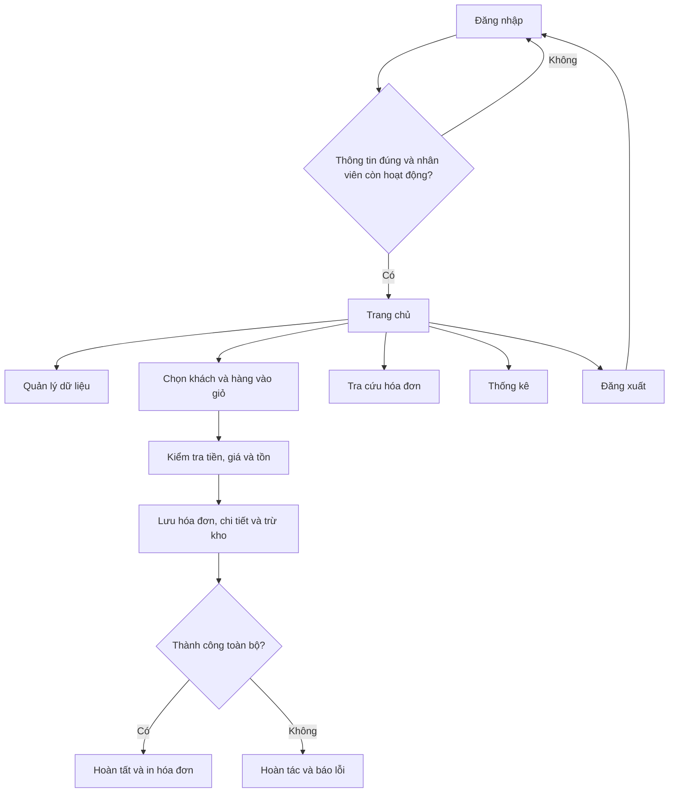

# Quản lý giày dép

**Java Swing · JDBC · SQL Server · 9 bảng · GUI → DAO**

## 1. Setup

1. Cài **JDK 17**, **VS Code + Extension Pack for Java**, **SQL Server + SSMS** và **Git**.
2. Clone repo rồi mở bằng VS Code:

```bash
git clone https://github.com/bacdevv/QuanLyGiayDep.git
cd QuanLyGiayDep
```

3. Trong SSMS, chạy `data/TaoCSDL.sql` rồi `data/DuLieuMau.sql` để tạo database và dữ liệu thử. Chỉ chạy một lần.
4. Sửa `url`, `user`, `password` trong `ConnectDB.java` theo máy mình.
5. Chạy `KiemTraKetNoi.java` để kiểm tra đủ 9 bảng.

## 2. Cách làm và GitHub

Làm theo thứ tự **Entity → DAO → GUI → test**.

```text
entity → thuộc tính, constructor, getter/setter
dao    → SQL và JDBC
gui    → giao diện, xử lý sự kiện và gọi DAO
```

Mỗi người tạo nhánh riêng:

```bash
git switch -c ngan
```

Đổi `ngan` thành `bac`, `thi` hoặc `phuc` theo người làm.

Trước buổi làm, commit phần đang làm rồi cập nhật:

```bash
git fetch origin
git merge origin/main
```

Làm xong thì kiểm tra và thêm đúng file đã sửa. Ví dụ:

```bash
git add .
git commit -m "Hoan thanh quan ly khach hang"
git push -u origin ngan
```

Tạo **Pull Request → mình review → merge**. Không push thẳng `main`.

### Cấu trúc file

**30 file Java:** 2 kết nối/kiểm tra, 9 entity, 10 DAO và 9 GUI. Entity/DAO vẫn tách theo dữ liệu để dễ viết JDBC; một GUI có thể gọi nhiều DAO.

| GUI | Nội dung | Người làm |
|---|---|---|
| `DangNhap_GUI` | Đăng nhập | Bắc |
| `TrangChu_GUI` | Cửa sổ chính, chứa các tab | Bắc |
| `TaiKhoan_GUI` | Tài khoản | Bắc |
| `ThongKe_GUI` | Thống kê | Bắc |
| `NhanVien_GUI` | Nhân viên | Ngần |
| `KhachHang_GUI` | Khách hàng | Ngần |
| `DanhMuc_GUI` | Danh mục + thương hiệu | Thi |
| `SanPham_GUI` | Mẫu sản phẩm + size–màu, giá và tồn | Thi |
| `HoaDon_GUI` | Bán hàng + tra cứu + chi tiết + in | Phúc |

Các màn hình con dùng `JPanel`, ghép vào `TrangChu_GUI`; không mở một cửa sổ cho mỗi bảng. Ảnh tham khảo chỉ dùng để hình dung bố cục. Không thêm nhập hàng, nhà cung cấp, tích điểm, thuế hoặc giảm giá từ ảnh vào phạm vi bài.

## 3. Phân công

| Thành viên           | Nhánh  | Phần phụ trách                                               |
| -------------------- | ------ | ------------------------------------------------------------ |
| Trần Việt Bắc        | `bac`  | Kết nối, tài khoản, đăng nhập, trang chủ, thống kê, ghép bài |
| Hoàng Thị Kim Ngần   | `ngan` | Nhân viên, khách hàng                                        |
| Nguyễn Phạm Đình Thi | `thi`  | Danh mục, thương hiệu, sản phẩm, size–màu                    |
| Hồng Phúc            | `phuc` | Hóa đơn, chi tiết hóa đơn, thanh toán, in                    |

Mỗi người làm **entity, DAO và GUI** phần mình. GUI chia theo chức năng, không chia theo từng bảng. Các phần quản lý cần có danh sách, chi tiết, thêm/sửa/xóa, tìm đơn giản và lọc kết hợp.

<details>
<summary>Bắc — kết nối, tài khoản và ghép bài</summary>

- [ ] Kết nối database, kiểm tra đủ 9 bảng.
- [ ] Đăng nhập: kiểm tra tài khoản, mật khẩu và nhân viên còn hoạt động.
- [ ] Lưu người đăng nhập; đăng xuất thì xóa phiên.
- [ ] Quản lý tài khoản: thêm/sửa/xóa, xem danh sách/chi tiết, tìm và lọc.
- [ ] Sửa để trống mật khẩu thì giữ cũ; chặn xóa tài khoản đang dùng.
- [ ] Thống kê doanh thu theo ngày, sản phẩm bán chạy và tồn hiện tại.
- [ ] Làm trang chủ, ghép các màn hình và test toàn bộ luồng.

</details>

<details>
<summary>Ngần — nhân viên và khách hàng</summary>

- [ ] Làm entity, DAO và GUI cho `NhanVien`, `KhachHang`.
- [ ] Thêm/sửa/xóa, danh sách/chi tiết, tìm và lọc.
- [ ] Kiểm tra tên, SĐT và dữ liệu liên kết.
- [ ] Nhân viên có hóa đơn thì ngừng hoạt động, không xóa lịch sử.
- [ ] Khách đã có hóa đơn thì chặn xóa.
- [ ] Test với Bắc: nhân viên nghỉ không đăng nhập được.

</details>

<details>
<summary>Thi — sản phẩm và size–màu</summary>

- [ ] Entity/DAO: `DanhMuc`, `ThuongHieu`, `SanPham`, `ChiTietSanPham`.
- [ ] GUI: `DanhMuc_GUI` gồm danh mục + thương hiệu; `SanPham_GUI` gồm mẫu + size–màu.
- [ ] Mỗi phần có đầy đủ chức năng quản lý trong màn hình đã gộp.
- [ ] Dùng ComboBox để chọn dữ liệu liên quan.
- [ ] Không trùng size–màu trong cùng mẫu; giá và tồn nằm ở biến thể.
- [ ] Chỉ nhập tồn ban đầu; biến thể đã bán không đổi sản phẩm/size/màu.
- [ ] Dữ liệu có liên kết thì chặn xóa; ngừng bán thì đổi trạng thái.
- [ ] Test với Phúc: thiếu tồn hoặc ngừng bán thì không bán được.

</details>

<details>
<summary>Phúc — bán hàng và hóa đơn</summary>

- [ ] Entity/DAO: `HoaDon`, `ChiTietHoaDon`; dùng chung `HoaDon_GUI` cho lập, tra cứu và chi tiết hóa đơn.
- [ ] Chọn khách/khách lẻ → chọn size–màu → số lượng → tính tiền.
- [ ] Chọn lại cùng biến thể thì cộng số lượng.
- [ ] Giỏ chưa thanh toán được sửa số lượng và xóa dòng.
- [ ] Chọn tiền mặt/chuyển khoản, xác nhận đã nhận tiền.
- [ ] Kiểm tra lại giá, trạng thái sản phẩm và tồn khi thanh toán.
- [ ] Lưu hóa đơn, chi tiết và trừ kho cùng transaction; lỗi thì rollback, thành công thì commit.
- [ ] Tra cứu theo ngày/mã → xem chi tiết → in hóa đơn.
- [ ] Hóa đơn đã thanh toán chỉ xem/in, không sửa/xóa.
- [ ] Phối hợp với Bắc lấy người lập hóa đơn, với Thi cập nhật tồn kho.

</details>

Mỗi người tự test phần mình, chụp màn hình và viết mô tả ngắn để đưa vào báo cáo.

## 4. Luồng nghiệp vụ


## 5. Ràng buộc

Đây là quy ước của nhóm cho cửa hàng ở Việt Nam. Mỗi người kiểm tra phần mình trước khi lưu dữ liệu.

### Quy định chung

| Dữ liệu | Quy định | Kiểm tra Java |
|---|---|---|
| Mã | 1–12 chữ không dấu, số, `_`, `-`; không trùng, không sửa sau khi tạo | `matches("[A-Za-z0-9_-]{1,12}")` |
| Tên | Cho nhập tiếng Việt có dấu, bỏ khoảng trắng đầu/cuối; không để trống | `trim()`, `isEmpty()`, `length()` |
| SĐT | Được trống; nếu nhập thì 10 số, bắt đầu bằng 03, 05, 07, 08 hoặc 09 | `matches("0[35789][0-9]{8}")` |
| Tiền | VND, số nguyên không âm; lưu bằng `BigDecimal`, SQL `decimal(18,0)` | `signum() >= 0`; không làm tròn tiền lẻ để cho qua |
| Số lượng | Số nguyên; bán > 0, tồn >= 0 | `Integer.parseInt()` rồi kiểm tra giá trị |
| Ngày | Giao diện hiển thị `dd/MM/yyyy`; trong Java dùng `LocalDate`/`LocalDateTime` | Không lưu chuỗi ngày vào cột SQL ngày giờ |

SĐT lưu bằng `String` để giữ số 0 đầu. Nhóm chỉ nhận dạng số di động nội địa 10 số, chưa nhận `+84` hoặc số bàn. Regex kiểm tra định dạng, không chứng minh số đang được sử dụng.

Ví dụ kiểm tra SĐT:

```java
String sdt = txtSoDienThoai.getText().trim();
if (!sdt.isEmpty() && !sdt.matches("0[35789][0-9]{8}")) {
    JOptionPane.showMessageDialog(this, "SĐT phải có 10 số, bắt đầu bằng 03, 05, 07, 08 hoặc 09.");
    return;
}
```

Ô được để trống thì lưu `null`, không lưu chuỗi `"null"`. Tên và dữ liệu tiếng Việt dùng cột `nvarchar` trong SQL Server.

### Theo từng bảng

| Bảng | Ràng buộc cần làm |
|---|---|
| `NhanVien` | Tên bắt buộc, tối đa 100 ký tự. SĐT theo quy định chung. `hoatDong = false` thì không được đăng nhập. |
| `TaiKhoan` | Mỗi nhân viên tối đa 1 tài khoản. Tên đăng nhập 1–50 chữ không dấu, số, `.`, `_`, `-`, không trùng. Mật khẩu 6–128 ký tự, không chỉ có khoảng trắng; băm trước khi lưu, hash tối đa 255 ký tự. |
| `DanhMuc` | Tên bắt buộc, tối đa 100 ký tự, không trùng trong bảng. Ví dụ: Giày thể thao, Sandal, Dép. |
| `ThuongHieu` | Tên bắt buộc, tối đa 100 ký tự, không trùng trong bảng. |
| `SanPham` | Tên bắt buộc, tối đa 150 ký tự. Phải chọn danh mục và thương hiệu có thật. Ngừng hoạt động thì không bán. |
| `ChiTietSanPham` | Phải chọn sản phẩm có thật. Size bắt buộc, tối đa 10 ký tự; màu bắt buộc, tối đa 30 ký tự. Không trùng sản phẩm–size–màu. Giá >= 0, tồn là số nguyên >= 0. |
| `KhachHang` | Tên bắt buộc, tối đa 100 ký tự. SĐT theo quy định chung, không bắt buộc duy nhất. |
| `HoaDon` | Người lập lấy từ tài khoản đăng nhập. Khách lẻ được để mã KH trống. Ngày lập lấy tự động. Thanh toán chỉ `TIENMAT` hoặc `CHUYENKHOAN`. Phải có ít nhất 1 dòng hàng. |
| `ChiTietHoaDon` | Hóa đơn và biến thể phải tồn tại. Số lượng > 0, không vượt tồn lúc chốt. Đơn giá >= 0, giữ giá lúc bán. Một biến thể chỉ có 1 dòng/hóa đơn. |

Size dùng chuỗi để hỗ trợ `39`, `40`, `40.5`, `S`, `M`, `L`; không tự giới hạn chỉ size người lớn. Màu nên chọn từ ComboBox thống nhất như Đen, Trắng, Nâu để tránh nhập nhiều tên cho cùng một màu.

### Tiền và quan hệ dữ liệu

```text
Thành tiền = số lượng × đơn giá lúc bán
Tổng hóa đơn = cộng thành tiền các dòng
Tiền thừa = tiền khách đưa − tổng hóa đơn
```

- Hiển thị tiền như `500.000 đ`; khi nhập giá chỉ nhập số như `500000`, không nhập dấu chấm hoặc chữ đ.
- Tiền mặt: khách đưa phải đủ. Chuyển khoản: xác nhận đã nhận tiền rồi mới lưu.
- Sửa tài khoản để trống mật khẩu thì giữ cũ; không tự trim mật khẩu vì khoảng trắng có thể thuộc mật khẩu.
- Khóa ngoại trong entity dùng đối tượng liên quan; khi ghi SQL lấy mã của đối tượng đó. Chỉ khách trong hóa đơn được phép `null`.
- Chỉ nhập tồn ban đầu khi tạo biến thể. Biến thể đã bán không đổi sản phẩm/size/màu; đổi giá bán không làm đổi hóa đơn cũ.
- Dữ liệu đang được tham chiếu thì chặn xóa. Nhân viên, sản phẩm, biến thể có lịch sử thì ngừng hoạt động khi cần, không xóa lịch sử.
- Hóa đơn đã thanh toán chỉ xem/in; lưu hóa đơn + chi tiết + trừ tồn cùng transaction, lỗi thì rollback.

SQL giữ PK/FK/UNIQUE/CHECK/NOT NULL. Java kiểm tra trước để báo lỗi dễ hiểu. Các quy định trên cần được triển khai trong từng phần, không có nghĩa toàn bộ code đã kiểm tra sẵn.
