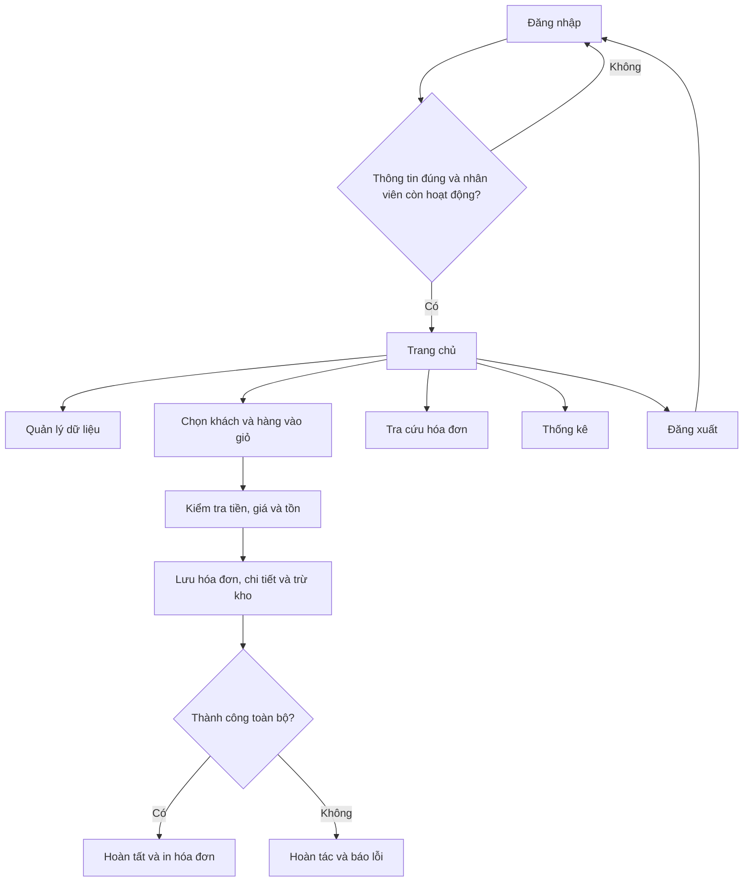

# Quản lý giày dép 👟

**Java Swing · JDBC · SQL Server · 9 bảng · GUI → DAO**

## 1. Setup

1. Cài **JDK 17**, **VS Code + Extension Pack for Java**, **SQL Server + SSMS** và **Git**.
2. Clone repo rồi mở bằng VS Code:

```bash
git clone https://github.com/bacdevv/QuanLyGiayDep.git
cd QuanLyGiayDep
```

3. Trong SSMS, chạy `data/TaoCSDL.sql` rồi `data/DuLieuMau.sql` để tạo database và dữ liệu thử. Chỉ chạy một lần.
4. Sửa `url`, `user`, `password` trong `ConnectDB.java` theo máy mình.
5. Chạy `KiemTraKetNoi.java` để kiểm tra đủ 9 bảng.

## 2. Cách làm và GitHub

Làm theo thứ tự **Entity → DAO → GUI → test**.

```text
entity → thuộc tính, constructor, getter/setter
dao    → SQL và JDBC
gui    → giao diện, xử lý sự kiện và gọi DAO

File: NhanVien.java, NhanVien_DAO.java, NhanVien_GUI.java
Biến: txtMaNV, lblMaNV, bttThem, cboDanhMuc, tableNhanVien...
```

Mỗi người tạo nhánh riêng:

```bash
git switch -c ngan
```

Đổi `ngan` thành `bac`, `thi` hoặc `phuc` theo người làm.

Trước buổi làm, commit phần đang làm rồi cập nhật:

```bash
git fetch origin
git merge origin/main
```

Làm xong thì kiểm tra và thêm đúng file đã sửa. Ví dụ:

```bash
git add .
git commit -m "Hoan thanh quan ly khach hang"
git push -u origin nganss
```

Tạo **Pull Request → mình review → merge**. Không push thẳng `main`.

## 3. Phân công

| Thành viên           | Nhánh  | Phần phụ trách                                               |
| -------------------- | ------ | ------------------------------------------------------------ |
| Trần Việt Bắc        | `bac`  | Kết nối, tài khoản, đăng nhập, trang chủ, thống kê, ghép bài |
| Hoàng Thị Kim Ngần   | `ngan` | Nhân viên, khách hàng                                        |
| Nguyễn Phạm Đình Thi | `thi`  | Danh mục, thương hiệu, sản phẩm, size–màu                    |
| Hồng Phúc            | `phuc` | Hóa đơn, chi tiết hóa đơn, thanh toán, in                    |

Mỗi người làm đủ **entity, DAO và GUI** phần mình. Các phần quản lý cần có danh sách, chi tiết, thêm/sửa/xóa, tìm đơn giản và lọc kết hợp.

<details>
<summary>Bắc — kết nối, tài khoản và ghép bài</summary>

- [ ] Kết nối database, kiểm tra đủ 9 bảng.
- [ ] Đăng nhập: kiểm tra tài khoản, mật khẩu và nhân viên còn hoạt động.
- [ ] Lưu người đăng nhập; đăng xuất thì xóa phiên.
- [ ] Quản lý tài khoản: thêm/sửa/xóa, xem danh sách/chi tiết, tìm và lọc.
- [ ] Sửa để trống mật khẩu thì giữ cũ; chặn xóa tài khoản đang dùng.
- [ ] Thống kê doanh thu theo ngày, sản phẩm bán chạy và tồn hiện tại.
- [ ] Làm trang chủ, ghép các màn hình và test toàn bộ luồng.

</details>

<details>
<summary>Ngần — nhân viên và khách hàng</summary>

- [ ] Làm entity, DAO và GUI cho `NhanVien`, `KhachHang`.
- [ ] Thêm/sửa/xóa, danh sách/chi tiết, tìm và lọc.
- [ ] Kiểm tra tên, SĐT và dữ liệu liên kết.
- [ ] Nhân viên có hóa đơn thì ngừng hoạt động, không xóa lịch sử.
- [ ] Khách đã có hóa đơn thì chặn xóa.
- [ ] Test với Bắc: nhân viên nghỉ không đăng nhập được.

</details>

<details>
<summary>Thi — sản phẩm và size–màu</summary>

- [ ] Làm `DanhMuc`, `ThuongHieu` → `SanPham` → `ChiTietSanPham`.
- [ ] Mỗi phần có entity, DAO, GUI và các chức năng quản lý.
- [ ] Dùng ComboBox để chọn dữ liệu liên quan.
- [ ] Không trùng size–màu trong cùng mẫu; giá và tồn nằm ở biến thể.
- [ ] Chỉ nhập tồn ban đầu; biến thể đã bán không đổi sản phẩm/size/màu.
- [ ] Dữ liệu có liên kết thì chặn xóa; ngừng bán thì đổi trạng thái.
- [ ] Test với Phúc: thiếu tồn hoặc ngừng bán thì không bán được.

</details>

<details>
<summary>Phúc — bán hàng và hóa đơn</summary>

- [ ] Làm entity, DAO và GUI cho `HoaDon`, `ChiTietHoaDon`.
- [ ] Chọn khách/khách lẻ → chọn size–màu → số lượng → tính tiền.
- [ ] Chọn lại cùng biến thể thì cộng số lượng.
- [ ] Giỏ chưa thanh toán được sửa số lượng và xóa dòng.
- [ ] Chọn tiền mặt/chuyển khoản, xác nhận đã nhận tiền.
- [ ] Kiểm tra lại giá, trạng thái sản phẩm và tồn khi thanh toán.
- [ ] Lưu hóa đơn, chi tiết và trừ kho cùng transaction; lỗi thì rollback, thành công thì commit.
- [ ] Tra cứu theo ngày/mã → xem chi tiết → in hóa đơn.
- [ ] Hóa đơn đã thanh toán chỉ xem/in, không sửa/xóa.
- [ ] Phối hợp với Bắc lấy người lập hóa đơn, với Thi cập nhật tồn kho.

</details>

Mỗi người tự test phần mình, chụp màn hình và viết mô tả ngắn để đưa vào báo cáo.

## 4. Luồng nghiệp vụ


