# Quản lý giày dép

**Java 17 · Swing · SQL Server · JDBC · VS Code · 3 lớp `GUI → BUS → DAO`**

> Đây là **project khung**: các class nghiệp vụ chưa có code. Chỉ `DBConnection.java` và `KiemTraKetNoi.java` có xử lý sẵn. Giao diện xem ảnh tham khảo của nhóm; README chỉ ghi **chức năng và điều kiện phải kiểm tra**.

**Mục lục:** [Chạy thử](#bat-dau) · [Phân công](#phan-cong) · [Chức năng](#chuc-nang) · [Quy trình](#quy-trinh) · [Ràng buộc Java](#rang-buoc) · [Git](#git)

<a id="bat-dau"></a>

## 1. Chạy thử

1. Cài **JDK 17**, **SQL Server + SSMS**, **Git**, **VS Code**; cài extension **Extension Pack for Java** và **SQL Server**.
2. SSMS: chạy `sql/TaoCSDL.sql` rồi `sql/DuLieuMau.sql` (mỗi file **một lần**).
3. Chép `mssql-jdbc-*.jre11.jar` và `jbcrypt-0.4.jar` vào `lib/`; sao chép `config/db.properties.example` → `config/db.properties`, điền tài khoản SQL Server.
4. Mở **thư mục gốc** `QuanLyGiayDep` trong VS Code → chạy `src/util/KiemTraKetNoi.java` để kiểm tra kết nối và **14 bảng**.

**Tài khoản mẫu:** `quanly` (quản lý) hoặc `nv03` (nhân viên bán hàng), mật khẩu mặc định `123456`. Các tài khoản `nv04` đến `nv12` cũng dùng mật khẩu này.

**Khi code:** `GUI` nhận dữ liệu, hiển thị lỗi → `BUS` kiểm tra điều kiện/nghiệp vụ → `DAO` dùng JDBC đọc/ghi SQL. Tiền dùng `BigDecimal`; SQL có tham số dùng `PreparedStatement`. Nhiều câu SQL trong một nghiệp vụ phải **commit/rollback**.

<a id="phan-cong"></a>

## 2. Phân công

| Thành viên               | Phân hệ và class GUI                                                                      | BUS / DAO                                            |
| ------------------------ | ----------------------------------------------------------------------------------------- | ---------------------------------------------------- |
| **Trần Việt Bắc**        | `DangNhapFrame`, `MainFrame`, `TaiKhoanFrame`, `ThongKeFrame`                             | Đăng nhập, tài khoản, thống kê, ghép project         |
| **Hoàng Thị Kim Ngần**   | `NhanVienFrame`, `KhachHangFrame`, `NhaCungCapFrame`                                      | Nhân viên, khách hàng, nhà cung cấp                  |
| **Nguyễn Phạm Đình Thi** | `SanPhamFrame`, `ChiTietSanPhamFrame`, `DanhMucFrame`, `ThuongHieuFrame`, `NhapHangFrame` | Sản phẩm, biến thể, danh mục, thương hiệu, nhập hàng |
| **Hồng Phúc**            | `HoaDonFrame`, `DoiTraFrame`                                                              | Hóa đơn, đổi/trả, `InvoicePrinter`                   |

**Quyền:** `QUAN_LY` quản lý toàn bộ; `BAN_HANG` bán hàng, khách hàng, tra cứu sản phẩm, lập/gửi phiếu nhập, xử lý đổi/trả theo phân quyền của nhóm. **BUS phải kiểm tra quyền**, không chỉ ẩn nút.

<a id="chuc-nang"></a>

## 3. Chức năng cần code

**Quy ước:** `CRUD` = **Thêm, Sửa, Xóa, Xem**. Mọi màn hình quản lý dữ liệu có **Tìm/Lọc** và **Làm mới** khi cần. **Làm mới không xóa dữ liệu SQL.** Không thêm nút `Lưu` riêng nếu nút `Thêm/Sửa` đã thực hiện lưu.

| Phần                   | Nút chính                                                                                                         | ComboBox / điều kiện                                                     |
| ---------------------- | ----------------------------------------------------------------------------------------------------------------- | ------------------------------------------------------------------------ |
| Đăng nhập              | **Đăng nhập**                                                                                                     | Đúng mật khẩu, tài khoản hoạt động, nhân viên đang làm                   |
| Trang chủ              | **Đăng xuất**                                                                                                     | Hiển thị nhân viên đang đăng nhập                                        |
| Nhân viên              | **Thêm, Sửa, Xóa, Tìm, Lọc, Làm mới, Chọn ảnh**                                                                   | Chức vụ, ca làm, trạng thái; có lịch sử thì chuyển `NGHI_VIEC`           |
| Tài khoản              | **Thêm, Sửa, Xóa, Tìm, Làm mới**                                                                                  | Nhân viên, vai trò, hoạt động; mật khẩu lưu **hash**                     |
| Khách hàng             | **Thêm, Sửa, Xóa, Tìm, Làm mới**                                                                                  | Giới tính; khách có hóa đơn không xóa cứng                               |
| Nhà cung cấp           | **Thêm, Sửa, Xóa, Tìm, Làm mới**                                                                                  | Hoạt động; có phiếu nhập thì ngừng hoạt động                             |
| Danh mục / Thương hiệu | **Thêm, Sửa, Xóa, Tìm, Làm mới**                                                                                  | Hoạt động; đã có sản phẩm thì không xóa cứng                             |
| Sản phẩm               | **Thêm, Sửa, Xóa, Tìm, Lọc, Làm mới, Chọn ảnh, Biến thể**                                                         | Danh mục, thương hiệu, hoạt động; **không nhập giá/tồn ở đây**           |
| Biến thể sản phẩm      | **Thêm, Sửa, Xóa, Tìm, Lọc, Làm mới**                                                                             | Size, màu, hoạt động, mức tồn; **giá/tồn theo SKU**                      |
| Bán hàng               | **Tạo hóa đơn, Thêm vào hóa đơn, Sửa số lượng, Xóa dòng, Thanh toán, Hủy hóa đơn, In hóa đơn, Tìm, Lọc, Làm mới** | Chọn SKU, số lượng, phương thức thanh toán; không bán quá tồn            |
| Nhập hàng              | **Tạo phiếu, Thêm dòng, Sửa dòng, Xóa dòng, Thực hiện, Tìm, Lọc, Làm mới**                                        | NCC; ComboBox hành động **Gửi duyệt / Duyệt / Từ chối / Hoàn tất / Hủy** |
| Đổi/trả                | **Tìm hóa đơn, Tạo phiếu, Thêm dòng, Sửa dòng, Xóa dòng, Thực hiện, Tìm, Lọc, Làm mới**                           | Loại **DOI / TRA**, tình trạng hàng, phương thức hoàn/thu                |
| Thống kê               | **Lọc, Làm mới**                                                                                                  | Loại thống kê, từ–đến ngày, phương thức thanh toán                       |

**Không làm:** tích điểm, voucher, giảm giá, thuế 2%, hạn sử dụng; không gắn nhà cung cấp trực tiếp vào sản phẩm. Đây là các chức năng của bài tham khảo, **không có trong CSDL nhóm**.

<a id="quy-trinh"></a>

## 4. Pipeline nghiệp vụ

**Đọc sơ đồ:** đi từ trái sang phải. Nếu **bất kỳ điều kiện nào sai → báo lỗi, không lưu SQL**. Các bước lưu nhiều bảng phải dùng JDBC **transaction** (lỗi → `rollback`). Bấm từng mục để xem.

<details>
<summary><b>Đăng nhập</b> — Bắc</summary>

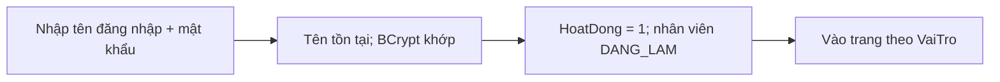

- Sai mật khẩu / tài khoản bị khóa / nhân viên `NGHI_VIEC` → **từ chối đăng nhập**.
- `VaiTro` chỉ được là `QUAN_LY` hoặc `BAN_HANG`; **BUS** kiểm tra quyền ở từng thao tác.

</details>

<details>
<summary><b>Nhân viên</b> — Ngần</summary>

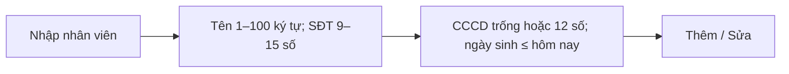

- `CCCD` nếu nhập → **đúng 12 chữ số**, kiểm tra trùng trong Java (SQL hiện **chưa có UNIQUE** cho CCCD).
- `MaNhanVien` không trùng; `ChucVu` không trống; `TrangThai` = `DANG_LAM` / `NGHI_VIEC`.
- Chọn `NGHI_VIEC` → tài khoản nhân viên **không được đăng nhập**; có giao dịch cũ → **không xóa cứng**.

</details>

<details>
<summary><b>Tài khoản</b> — Bắc</summary>

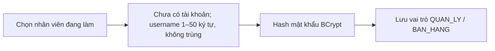

- Một `MaNhanVien` chỉ có **tối đa 1** tài khoản; `MatKhau` **không lưu dạng rõ**.
- `HoatDong = 0` → chặn đăng nhập; khóa tài khoản **không xóa** lịch sử nhân viên.

</details>

<details>
<summary><b>Khách hàng</b> — Ngần</summary>

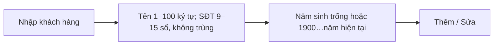

- Khách có hóa đơn → **không xóa cứng**; khách vãng lai: `HOADON.MaKH = NULL`.
- Không có tích điểm hoặc tài khoản đăng nhập của khách hàng.

</details>

<details>
<summary><b>Nhà cung cấp</b> — Ngần</summary>

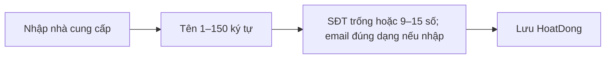

- `HoatDong = 0` → **không chọn cho phiếu nhập mới**; có phiếu nhập cũ → **không xóa cứng**.
- Nhà cung cấp gắn với **phiếu nhập**, không liên kết trực tiếp `SANPHAM`.

</details>

<details>
<summary><b>Danh mục / Thương hiệu</b> — Thi</summary>

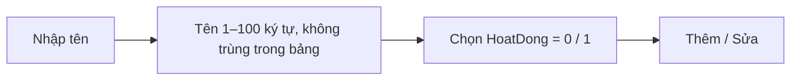

- `HoatDong = 0` → **không chọn khi thêm sản phẩm**.
- Đã có sản phẩm tham chiếu → **không xóa cứng**.

</details>

<details>
<summary><b>Sản phẩm</b> — Thi</summary>

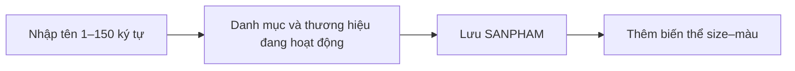

- `MaSP` không trùng; sản phẩm `HoatDong = 0` → **không bán**.
- **Không nhập** `GiaBan`, `SoLuongTon` trên `SanPhamFrame` — chúng thuộc biến thể.

</details>

<details>
<summary><b>Biến thể sản phẩm (size–màu)</b> — Thi</summary>

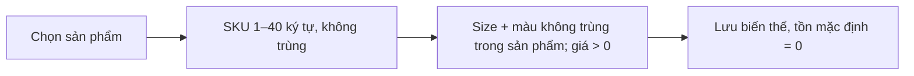

- `KichCo` 1–10 ký tự; `MauSac` 1–30 ký tự; `MucTonToiThieu ≥ 0`.
- `SoLuongTon ≥ 0` (**không sửa tay**) — cộng khi hoàn tất nhập, trừ khi bán, xử lý riêng khi đổi/trả.

</details>

<details>
<summary><b>Bán hàng</b> — Phúc</summary>

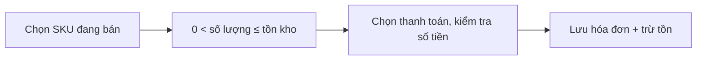

- Tiền mặt: `TienKhachDua ≥ TongThanhToan - TienBuTruDoiTra`; các phương thức theo `HOADON` trong SQL.
- Có ít nhất **1 dòng**, `DonGia > 0`; một SKU chỉ **1 dòng/hóa đơn** (chọn lại → cộng số lượng).
- Chỉ `CHO_THANH_TOAN → DA_THANH_TOAN` một lần. SQL lỗi → **rollback toàn bộ**, không mất tồn kho.

</details>

<details>
<summary><b>Nhập hàng</b> — Thi</summary>

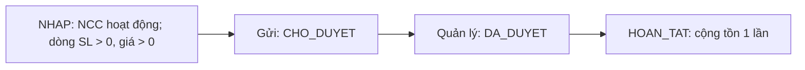

- Phiếu phải có **ít nhất 1 dòng**; cùng SKU chỉ **1 dòng/phiếu**; chỉ `NHAP` được sửa dòng.
- Quản lý có thể `TU_CHOI`; hủy theo trạng thái được phép. Không cộng tồn ở bước **duyệt**.
- Hoàn tất lỗi → **rollback**; không được `HOAN_TAT` hai lần.

</details>

<details>
<summary><b>Đổi / trả</b> — Phúc</summary>

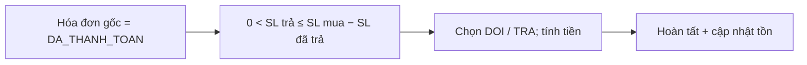

- `TRA`: `MaHDMoi = NULL`; `DOI`: cần hóa đơn mới **khác hóa đơn cũ**, hàng đổi ra đủ tồn.
- `BAN_LAI_DUOC` → cộng tồn hàng trả; `HANG_LOI` → **không cộng**.
- `SoTienHoan ≥ 0`, `SoTienThuThem ≥ 0`, **không đồng thời > 0**; chỉ hoàn tất một lần, lỗi → **rollback**.

</details>

<details>
<summary><b>Thống kê</b> — Bắc</summary>

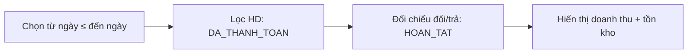

- Không tính hóa đơn `HUY` hay `CHO_THANH_TOAN` vào doanh thu bán đã chốt.
- Thống kê theo phương thức thanh toán; khi tính doanh thu thuần phải xét **hoàn/thu thêm do đổi trả**, tránh tính trùng.

</details>

<a id="rang-buoc"></a>

## 5. Ràng buộc thuộc tính trong Java

**Cách đọc:** `Bắt buộc` = không bỏ trống; `Có thể trống` = có thể để `null`; `không trùng` = kiểm tra trước khi lưu; `chỉ đọc` = người dùng không nhập tay. **Mã** (`Ma...`) tối đa **12 ký tự**, bắt buộc, không được trùng trong bảng và không sửa sau khi tạo. **Mã liên kết** phải tồn tại ở bảng liên quan.

**Ví dụ báo lỗi rõ ràng:** `TenKH = "   "` → “Tên khách hàng không được trống”; `SoLuong = 0` → “Số lượng phải lớn hơn 0”; `GiaBan = -1000` → “Giá bán phải lớn hơn 0”. Chuỗi nhập dùng `trim()`; giữ số điện thoại/CCCD là **String** để không mất số `0` đầu.

<details>
<summary><b>1. NhanVien.java</b> — Ngần</summary>

| Thuộc tính    | Java kiểm tra                                                 |
| ------------- | ------------------------------------------------------------- |
| `MaNhanVien`  | Mã duy nhất, tối đa 12 ký tự; không cho sửa mã.               |
| `TenNhanVien` | **Bắt buộc**, không chỉ có khoảng trắng, tối đa 100 ký tự.    |
| `NgaySinh`    | Có thể trống; nếu có, phải là ngày hợp lệ, không ở tương lai. |
| `SoDienThoai` | **Bắt buộc**, 9–15 **chữ số**. Ví dụ `0912345678`.            |
| `Email`       | Có thể trống; nếu có, đúng dạng email, tối đa 100 ký tự.      |
| `CCCD`        | Có thể trống; nếu có, đúng **12 chữ số**.                     |
| `DiaChi`      | Có thể trống, tối đa 255 ký tự.                               |
| `GioiTinh`    | Có thể trống; nếu chọn: **Nam / Nữ / Khác**.                  |
| `ChucVu`      | **Bắt buộc**, tối đa 50 ký tự; **không dùng thay `VaiTro`**.  |
| `CaLam`       | Có thể trống, tối đa 30 ký tự.                                |
| `TrangThai`   | **DANG_LAM / NGHI_VIEC**; nghỉ việc → chặn đăng nhập.         |
| `HinhAnh`     | Có thể trống; lưu đường dẫn ảnh, tối đa 255 ký tự.            |

</details>

<details>
<summary><b>2. TaiKhoan.java</b> — Bắc</summary>

| Thuộc tính    | Java kiểm tra                                                                                            |
| ------------- | -------------------------------------------------------------------------------------------------------- |
| `MaTK`        | Mã duy nhất, tối đa 12 ký tự.                                                                            |
| `MaNhanVien`  | **Bắt buộc**, nhân viên có thật; **mỗi nhân viên tối đa 1 tài khoản**.                                   |
| `TenDangNhap` | **Bắt buộc**, không trùng, tối đa 50 ký tự.                                                              |
| `MatKhau`     | Nhập mật khẩu khi tạo/đổi; **hash BCrypt trước khi lưu**, không lưu mật khẩu gốc; hash tối đa 255 ký tự. |
| `VaiTro`      | Chỉ **QUAN_LY / BAN_HANG**.                                                                              |
| `HoatDong`    | **Có / Không**; không hoạt động → không đăng nhập.                                                       |
| `NgayTao`     | **Tự động** khi tạo; không sửa tay.                                                                      |

</details>

<details>
<summary><b>3. DanhMuc.java</b> — Thi</summary>

| Thuộc tính   | Java kiểm tra                                            |
| ------------ | -------------------------------------------------------- |
| `MaDanhMuc`  | Mã duy nhất, tối đa 12 ký tự.                            |
| `TenDanhMuc` | **Bắt buộc**, không trùng, tối đa 100 ký tự.             |
| `HoatDong`   | **Có / Không**; tắt thì không chọn khi tạo sản phẩm mới. |

</details>

<details>
<summary><b>4. ThuongHieu.java</b> — Thi</summary>

| Thuộc tính      | Java kiểm tra                                            |
| --------------- | -------------------------------------------------------- |
| `MaThuongHieu`  | Mã duy nhất, tối đa 12 ký tự.                            |
| `TenThuongHieu` | **Bắt buộc**, không trùng, tối đa 100 ký tự.             |
| `HoatDong`      | **Có / Không**; tắt thì không chọn khi tạo sản phẩm mới. |

</details>

<details>
<summary><b>5. SanPham.java</b> — Thi</summary>

| Thuộc tính     | Java kiểm tra                                                     |
| -------------- | ----------------------------------------------------------------- |
| `MaSP`         | Mã duy nhất, tối đa 12 ký tự.                                     |
| `MaDanhMuc`    | **Bắt buộc**, chọn danh mục đang hoạt động.                       |
| `MaThuongHieu` | **Bắt buộc**, chọn thương hiệu đang hoạt động.                    |
| `TenSP`        | **Bắt buộc**, tối đa 150 ký tự.                                   |
| `ChatLieu`     | Có thể trống, tối đa 100 ký tự.                                   |
| `MoTa`         | Có thể trống, tối đa 500 ký tự.                                   |
| `HinhAnh`      | Có thể trống; đường dẫn ảnh tối đa 255 ký tự.                     |
| `HoatDong`     | **Có / Không**; có lịch sử liên quan → ngừng bán, không xóa cứng. |

**Lưu ý:** Giá, size, màu, tồn kho **không nằm trong `SANPHAM`**, mà nằm trong `CHITIETSANPHAM`.

</details>

<details>
<summary><b>6. ChiTietSanPham.java</b> — Thi</summary>

| Thuộc tính       | Java kiểm tra                                                                   |
| ---------------- | ------------------------------------------------------------------------------- |
| `MaCTSP`         | Mã duy nhất, tối đa 12 ký tự.                                                   |
| `MaSP`           | **Bắt buộc**, chọn sản phẩm có thật.                                            |
| `SKU`            | **Bắt buộc**, không trùng toàn cửa hàng, tối đa 40 ký tự.                       |
| `KichCo`         | **Bắt buộc**, tối đa 10 ký tự. Cùng 1 sản phẩm không được trùng **size + màu**. |
| `MauSac`         | **Bắt buộc**, tối đa 30 ký tự; kiểm tra cùng `KichCo`.                          |
| `GiaBan`         | **Lớn hơn 0**; số tiền nguyên VND, dùng `BigDecimal`.                           |
| `SoLuongTon`     | Số nguyên **từ 0 trở lên**; **không cho sửa trực tiếp** ở màn hình.             |
| `MucTonToiThieu` | Số nguyên **từ 0 trở lên**, mặc định **2**.                                     |
| `HoatDong`       | **Có / Không**; ngừng hoạt động → không bán.                                    |

**Trạng thái lọc tồn:** `0 = Hết hàng`; `1 ... MucTonToiThieu = Sắp hết`; lớn hơn mức đó = `Còn hàng` (nếu mức tối thiểu = 0, không có khoảng “sắp hết”).

</details>

<details>
<summary><b>7. NhaCungCap.java</b> — Ngần</summary>

| Thuộc tính    | Java kiểm tra                                                  |
| ------------- | -------------------------------------------------------------- |
| `MaNCC`       | Mã duy nhất, tối đa 12 ký tự.                                  |
| `TenNCC`      | **Bắt buộc**, tối đa 150 ký tự.                                |
| `SoDienThoai` | Có thể trống; nếu nhập phải là **9–15 chữ số**.                |
| `Email`       | Có thể trống; nếu nhập phải đúng dạng email, tối đa 100 ký tự. |
| `DiaChi`      | Có thể trống, tối đa 255 ký tự.                                |
| `HoatDong`    | **Có / Không**; có lịch sử nhập → không xóa cứng.              |

</details>

<details>
<summary><b>8. KhachHang.java</b> — Ngần</summary>

| Thuộc tính    | Java kiểm tra                                                          |
| ------------- | ---------------------------------------------------------------------- |
| `MaKH`        | Mã duy nhất, tối đa 12 ký tự.                                          |
| `TenKH`       | **Bắt buộc**, không trống, tối đa 100 ký tự.                           |
| `NamSinh`     | Có thể trống; nếu nhập phải là **số nguyên từ 1900 đến năm hiện tại**. |
| `GioiTinh`    | Có thể trống; nếu chọn: **Nam / Nữ / Khác**, tối đa 10 ký tự.          |
| `SoDienThoai` | **Bắt buộc**, **9–15 chữ số**, **không trùng** khách hàng khác.        |
| `DiaChi`      | Có thể trống, tối đa 255 ký tự.                                        |

**Khách vãng lai:** hóa đơn có thể để `MaKH = null`; **không cần tạo khách hàng giả**.

</details>

<details>
<summary><b>9. HoaDon.java</b> — Phúc</summary>

| Thuộc tính            | Java kiểm tra                                                                                   |
| --------------------- | ----------------------------------------------------------------------------------------------- |
| `MaHD`                | Mã duy nhất, tối đa 12 ký tự.                                                                   |
| `MaNhanVien`          | **Bắt buộc**, lấy từ người đang đăng nhập.                                                      |
| `MaKH`                | Có thể trống (**khách vãng lai**); nếu có phải là mã khách tồn tại.                             |
| `NgayLap`             | **Tự động** khi tạo, không nhập tay.                                                            |
| `TrangThai`           | **CHO_THANH_TOAN / DA_THANH_TOAN / HUY**; đã thanh toán/hủy thì không xử lý lại.                |
| `PhuongThucThanhToan` | Khi thanh toán: **TIEN_MAT / CHUYEN_KHOAN / QUET_THE**; `BU_TRU` chỉ dùng khi đổi hàng phù hợp. |
| `TongThanhToan`       | **Tự tính** từ chi tiết; số tiền **≥ 0**, không nhập tay.                                       |
| `TienBuTruDoiTra`     | **0 ≤ bù trừ ≤ tổng tiền**; bán bình thường = 0.                                                |
| `TienKhachDua`        | Có thể trống; nếu tiền mặt, số đưa **≥ tiền còn phải trả**.                                     |
| `NgayThanhToan`       | **Tự động** khi `DA_THANH_TOAN`; trạng thái khác phải để trống.                                 |

</details>

<details>
<summary><b>10. ChiTietHoaDon.java</b> — Phúc</summary>

| Thuộc tính  | Java kiểm tra                                                           |
| ----------- | ----------------------------------------------------------------------- |
| `MaCTHD`    | Mã duy nhất, tối đa 12 ký tự.                                           |
| `MaHD`      | **Bắt buộc**, hóa đơn có thật và chưa thanh toán/hủy khi sửa dòng.      |
| `MaCTSP`    | **Bắt buộc**, SKU có thật; **một SKU chỉ một dòng trong cùng hóa đơn**. |
| `SoLuong`   | Số nguyên **> 0**, không vượt tồn tại lúc chốt thanh toán.              |
| `DonGia`    | **> 0**, lấy giá lúc mua để giữ lịch sử; dùng `BigDecimal`.             |
| `ThanhTien` | **SQL tự tính** = `SoLuong × DonGia`; Java chỉ hiển thị.                |

</details>

<details>
<summary><b>11. PhieuNhap.java</b> — Thi</summary>

| Thuộc tính        | Java kiểm tra                                               |
| ----------------- | ----------------------------------------------------------- |
| `MaPN`            | Mã duy nhất, tối đa 12 ký tự.                               |
| `MaNhanVien`      | **Bắt buộc**, lấy từ người lập đang đăng nhập.              |
| `MaNCC`           | **Bắt buộc**, chọn nhà cung cấp đang hoạt động.             |
| `MaNhanVienDuyet` | Có thể trống khi chưa duyệt; khi duyệt phải là quản lý.     |
| `NgayLap`         | **Tự động** khi tạo.                                        |
| `NgayDuyet`       | Chỉ có khi đã ghi người duyệt; không nhập tay.              |
| `NgayHoanTat`     | Chỉ có khi `HOAN_TAT`; không nhập tay.                      |
| `TrangThai`       | **NHAP / CHO_DUYET / DA_DUYET / HOAN_TAT / TU_CHOI / HUY**. |
| `TongTien`        | **Tự cộng** tiền các dòng, **≥ 0**; không nhập tay.         |
| `GhiChu`          | Có thể trống, tối đa 500 ký tự.                             |

**Chỉ phiếu `NHAP` được sửa dòng**; `HOAN_TAT` cộng tồn một lần, không cho hoàn tất lại.

</details>

<details>
<summary><b>12. ChiTietPhieuNhap.java</b> — Thi</summary>

| Thuộc tính   | Java kiểm tra                                                |
| ------------ | ------------------------------------------------------------ |
| `MaCTPN`     | Mã duy nhất, tối đa 12 ký tự.                                |
| `MaPN`       | **Bắt buộc**, phiếu nhập có thật và còn `NHAP` nếu sửa dòng. |
| `MaCTSP`     | **Bắt buộc**, SKU có thật; **mỗi SKU chỉ một dòng/phiếu**.   |
| `SoLuong`    | Số nguyên **> 0**, không nhập số âm/chữ.                     |
| `DonGiaNhap` | **> 0**, dùng `BigDecimal`.                                  |
| `ThanhTien`  | **SQL tự tính** = `SoLuong × DonGiaNhap`; Java chỉ hiển thị. |

</details>

<details>
<summary><b>13. PhieuDoiTra.java</b> — Phúc</summary>

| Thuộc tính           | Java kiểm tra                                                                               |
| -------------------- | ------------------------------------------------------------------------------------------- |
| `MaPDT`              | Mã duy nhất, tối đa 12 ký tự.                                                               |
| `MaHDCu`             | **Bắt buộc**, hóa đơn gốc phải `DA_THANH_TOAN`.                                             |
| `MaHDMoi`            | `DOI`: phải có hóa đơn mới **khác** hóa đơn cũ, không gắn với 2 phiếu; `TRA`: **để trống**. |
| `MaNhanVien`         | **Bắt buộc**, lấy từ người xử lý đang đăng nhập.                                            |
| `LoaiXuLy`           | Chỉ **DOI / TRA**.                                                                          |
| `NgayLap`            | **Tự động** khi tạo.                                                                        |
| `NgayHoanTat`        | Chỉ có khi `HOAN_TAT`; không nhập tay.                                                      |
| `LyDo`               | **Bắt buộc**, tối đa 255 ký tự.                                                             |
| `TrangThai`          | **NHAP / HOAN_TAT / HUY**; không hoàn tất/hủy lại.                                          |
| `TongGiaTriTra`      | **Tự tính**, **≥ 0** từ các dòng hàng trả.                                                  |
| `TongGiaTriDoi`      | **Tự tính**, **≥ 0** từ hàng mới; `TRA` = 0.                                                |
| `SoTienHoan`         | **≥ 0**; nếu > 0 thì `SoTienThuThem` phải = 0.                                              |
| `SoTienThuThem`      | **≥ 0**; nếu > 0 thì `SoTienHoan` phải = 0.                                                 |
| `PhuongThucHoanTien` | Có tiền hoàn thì chọn **TIEN_MAT / CHUYEN_KHOAN / QUET_THE**.                               |
| `PhuongThucThuThem`  | Có thu thêm thì chọn **TIEN_MAT / CHUYEN_KHOAN / QUET_THE**.                                |
| `GhiChu`             | Có thể trống, tối đa 500 ký tự.                                                             |

</details>

<details>
<summary><b>14. ChiTietDoiTra.java</b> — Phúc</summary>

| Thuộc tính      | Java kiểm tra                                                      |
| --------------- | ------------------------------------------------------------------ |
| `MaCTDT`        | Mã duy nhất, tối đa 12 ký tự.                                      |
| `MaPDT`         | **Bắt buộc**, phiếu có thật và đang `NHAP` nếu sửa dòng.           |
| `MaCTSP`        | **Bắt buộc**, hàng thuộc hóa đơn gốc; một SKU chỉ một dòng/phiếu.  |
| `SoLuong`       | Số nguyên **> 0**, **không quá số đã mua trừ số đã trả trước đó**. |
| `DonGiaHoan`    | **> 0**, lấy đúng giá SKU trên hóa đơn gốc.                        |
| `ThanhTienHoan` | **SQL tự tính** = `SoLuong × DonGiaHoan`; Java chỉ hiển thị.       |
| `TinhTrangHang` | **BAN_LAI_DUOC** → cộng lại tồn; **HANG_LOI** → không cộng.        |

</details>

**Quan trọng:** Ràng buộc độ dài, khóa ngoại, trạng thái, `UNIQUE/CHECK` dựa trên `sql/TaoCSDL.sql`. Kiểm tra định dạng email/điện thoại, không cho ngày tương lai và các quy tắc thao tác là **phần Java BUS cần bổ sung**. Với dữ liệu đã phát sinh hóa đơn/phiếu, ưu tiên **ngừng hoạt động** thay vì xóa mất lịch sử.

<a id="git"></a>

## 6. Git / GitHub

**Bắc** tạo repository và mời 3 bạn. Mỗi người làm nhánh riêng: `bac`, `ngan`, `thi`, `phuc`; không push thẳng lên `main`.

```bash
git clone https://github.com/TAI_KHOAN/QuanLyGiayDep.git
cd QuanLyGiayDep
git switch -c ngan       # Thay bằng tên nhánh của mình
git add .
git commit -m "Lam khach hang"
git push -u origin ngan
```

Lần sau: `git pull origin main` để cập nhật trước khi code (giải quyết xung đột nếu có); xong thì `git add .` → `git commit -m "Noi dung"` → `git push` → tạo **Pull Request** để Bắc duyệt. **Không commit** `config/db.properties`, mật khẩu hoặc file JAR.
